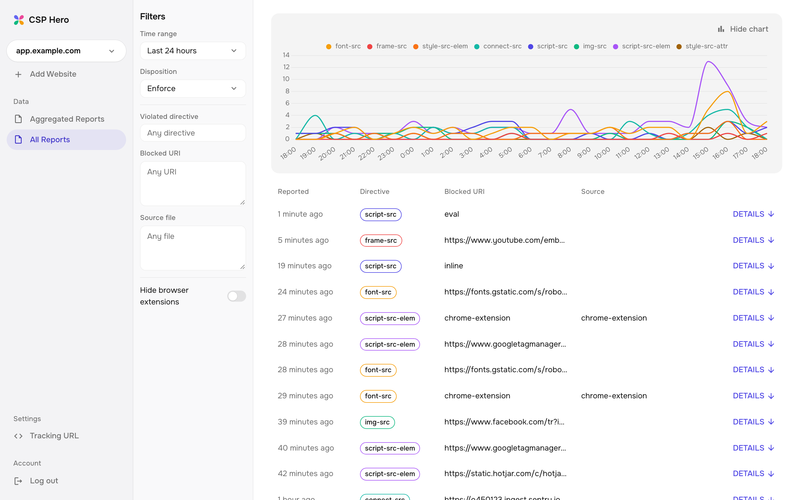
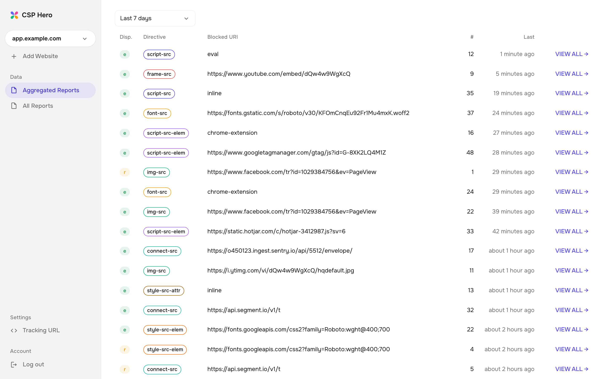
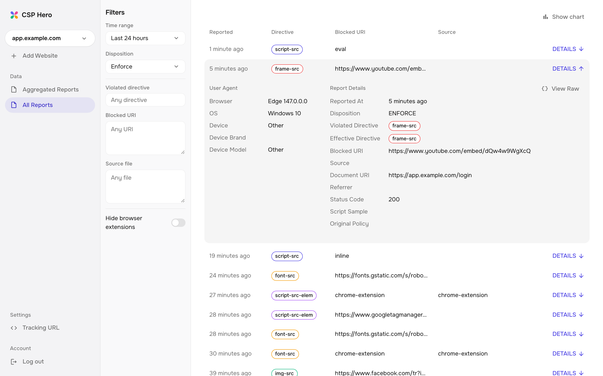
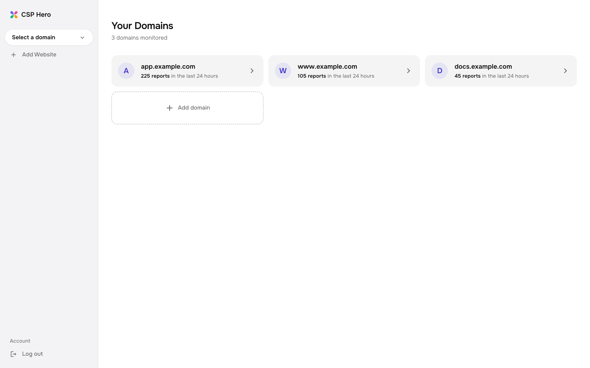
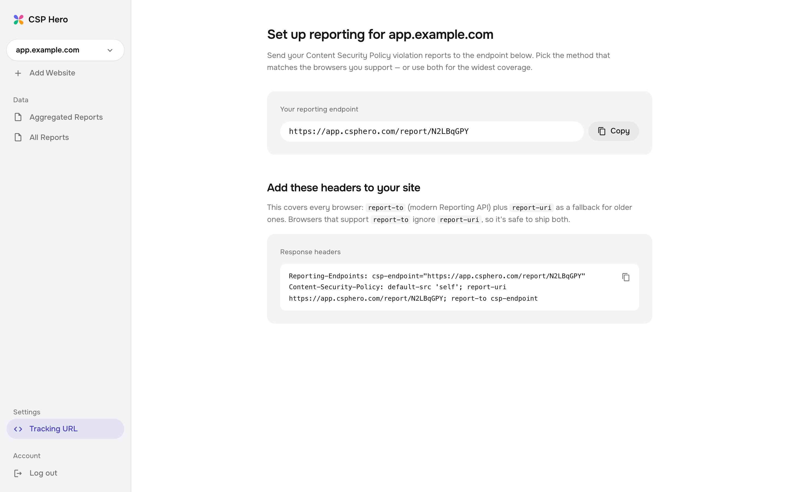

# CSP Hero

[](https://github.com/odosui/csphero/actions/workflows/test.yml)
[](https://github.com/odosui/csphero/actions/workflows/docker.yml)
[](https://hub.docker.com/r/hiquest/csphero)
[](https://hub.docker.com/r/hiquest/csphero)
[](LICENSE)

CSP Hero is a **free**, **open-source** server and dashboard designed to help developers collect and analyze [Content Security Policy (CSP)](https://developer.mozilla.org/en-US/docs/Web/HTTP/Guides/CSP) reports.

> The easiest way to try CSP Hero is in [our cloud service](https://www.csphero.com/).



---

## Features

- **Collect CSP reports**: one endpoint per website accepts both the modern Reporting API (`report-to`) and the legacy `report-uri` format.
- **See violations over time**: a chart per directive for the last 24 hours, 7, 30 or 90 days, so a broken deploy shows up as a spike.
- **Filter down to what matters**: by disposition (enforce or report-only), directive, blocked URI and source file, and hide the noise from users' browser extensions with one switch.
- **Aggregated view**: identical violations are grouped with a count and when they last happened, one click away from every report behind them.
- **Report details**: the parsed report, the browser, OS and device it came from, and the raw payload.
- **Multiple websites**: monitor several domains from one account, each with its own reporting endpoint.

## Screenshots

<table>
  <tr>
    <td width="50%">
      
      <p align="center"><b>Aggregated reports</b>: identical violations grouped, with a count</p>
    </td>
    <td width="50%">
      
      <p align="center"><b>Report details</b>: what was blocked, where, and in which browser</p>
    </td>
  </tr>
  <tr>
    <td width="50%">
      
      <p align="center"><b>Your domains</b>: every website and its last 24 hours</p>
    </td>
    <td width="50%">
      
      <p align="center"><b>Setup</b>: the endpoint and headers to copy into your site</p>
    </td>
  </tr>
</table>

## Quick start with Docker

A public docker image is available on [Docker Hub](https://hub.docker.com/r/hiquest/csphero).

Have a look at the [docker-compose example](docker-compose.yml) to quickly start CSP Hero with Docker.

```bash
docker compose up -d
```

On startup a one-shot `migrate` service runs the database migrations once, and the `web` and `worker` services only start after it completes. This keeps deploys safe when running more than one app container against the same database — migrations never race per-pod. In Kubernetes, run the same `bin/rails db:prepare` step as an init container or a pre-deploy Job before starting the app pods.

Make sure to set the `SECRET_KEY_BASE` environment variable to a secure random value, as it is used to sign session cookies.

Also, since we need a postgresql database, you need to set the `DB_HOST`, `DB_PORT`, `DB_USER`, `DB_PASSWORD`, and `DB_NAME` environment variables to connect to your database.

## Local development

You need Ruby 3.4, Node.js and PostgreSQL running locally.

```bash
npm install
bin/setup     # installs gems, prepares the database, starts the dev server
```

`bin/dev` starts the Rails server on [localhost:3000](http://localhost:3000), the Vite dev server and the TypeScript type checker.

To fill the dashboard with realistic data, sign up in the app, then run:

```bash
bin/rails db:seed
```

In development this adds three websites to the first user's account, with about 1,100 CSP reports spread over the last 90 days. Running it again replaces the seeded reports and leaves real ones alone.

## What is a Content Security Policy?

[Content Security Policy](https://developer.mozilla.org/en-US/docs/Web/HTTP/Guides/CSP) allows developers to define which resources are allowed to load on their web pages, helping to prevent cross-site scripting (XSS) attacks and other vulnerabilities.

When a violation occurs, the browser sends a report to the provided endpoint (via [report-uri](https://developer.mozilla.org/en-US/docs/Web/HTTP/Reference/Headers/Content-Security-Policy/report-uri) or [report-to](https://developer.mozilla.org/en-US/docs/Web/HTTP/Reference/Headers/Content-Security-Policy/report-to) directive), which can be collected and analyzed.

CSP Hero provides an endpoint to collect these reports and a dashboard to analyze and visualize them.

## Extra tools

Several free tools are available online (soon to be open-sourced):

- [CSP Builder](https://www.csphero.com/csp-builder) allows you to create a CSP policy with a user-friendly interface.
- [CSP Validator](https://www.csphero.com/csp-validator) validates your CSP policy and suggests improvements.
